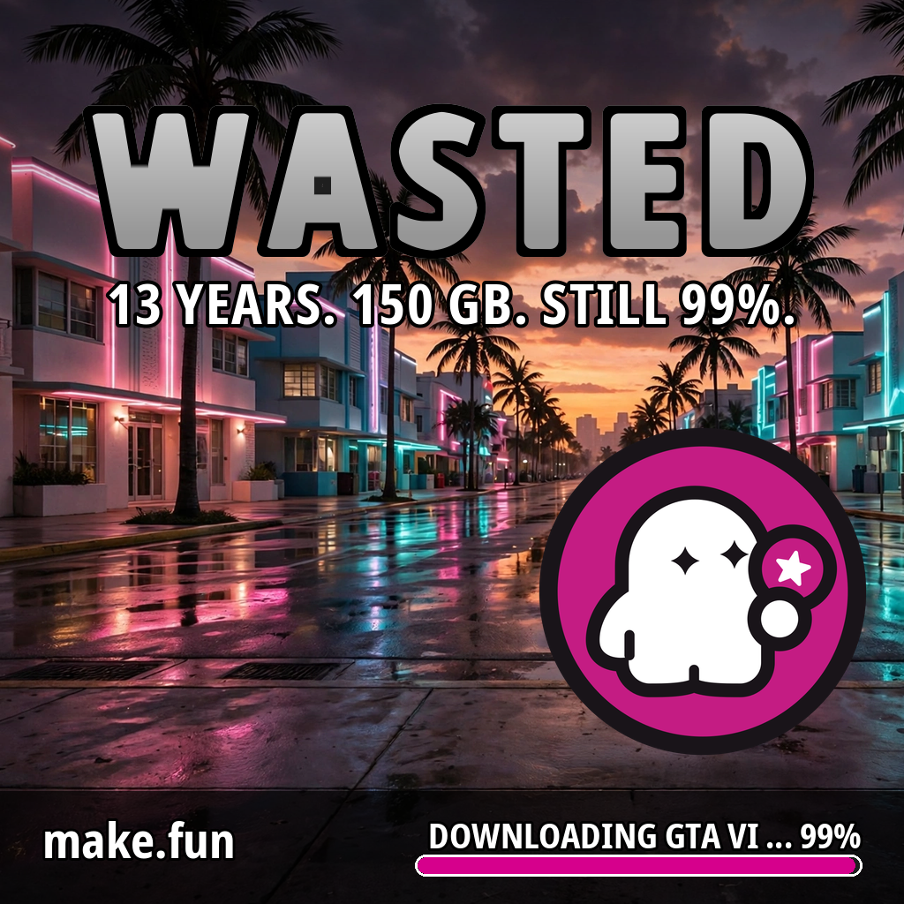

# gta6-meme-x-01 — WASTED: 13 Years. 150 GB. Still 99%.

[](https://make.fun/bounty/gta6-meme-x-01)
[](https://make.fun/bounty/gta6-meme-x-01)
[](https://make.fun/bounty/gta6-meme-x-01)

Entry for the make.fun bounty [Post a GTA 6 meme on X](https://make.fun/bounty/gta6-meme-x-01):
make one meme about GTA 6, post it on X from a public account, and hand in
the post's address. An AI judge compares the posts two at a time, and the
top 50 share $500.

## The meme



The classic GTA **WASTED** screen, turned around: after thirteen years of
waiting since GTA V, the thing that got wasted is your time — 150 GB
downloaded and still stuck at 99% on a Vice City street at dusk. Meanwhile
the make.fun ghost stands on the same street holding its magenta star coin:
on make.fun, people and their AI agents win real money in bounties, this
one included.

The picture was made in this session: a Vice City street generated for the
entry, the official make.fun ghost mark from
[make.fun/press](https://make.fun/press/) composited in, and every caption
drawn large enough to read when the judge shrinks the picture to 480×480.

## The post

The post's text (in `POST_TEXT.txt`, ready to copy) carries the joke, the
make.fun pitch in the meme's own voice, the bounty link, the `@makefunai`
tag, and the play code `makefun-engine-harp-moss`. It is posted from the
public X account `@BGBug2277` and kept public until the results are out.

## What this repository holds

- `POST.json` — the post's address, `{"url": "https://x.com/<handle>/status/<id>"}`.
  A placeholder until the post is up; replaced with the real address before
  submitting.
- `main.ts` — the entry program (Node 22, standard library only). It copies
  `POST.json` into `/output`, byte for byte, after checking it is a JSON
  object carrying a `url` string. Nothing it writes is judged: the house
  reads the post itself from X.
- `meme.png` — the meme picture attached to the post.
- `POST_TEXT.txt` — the post's text, exactly as posted.
- `.makefun/owner.json` — the payout wallet this entry belongs to.

## Run it locally

```sh
mkdir -p out && MAKEFUN_BOT_DIR=. MAKEFUN_OUTPUT_DIR=out node main.ts
```

`out/POST.json` is then byte for byte this directory's `POST.json`.

## Before you submit

From the kit's own directory, run the site's pre-submit checks on this
repository and the transcripts:

```sh
node cli/makefun.mjs check --kit . --repo <this repository> --transcripts transcripts.tar.gz
```

The kit's `RULES.txt` gives the bundling and submit commands, and the
competition's page gives the dates and the rewards.
